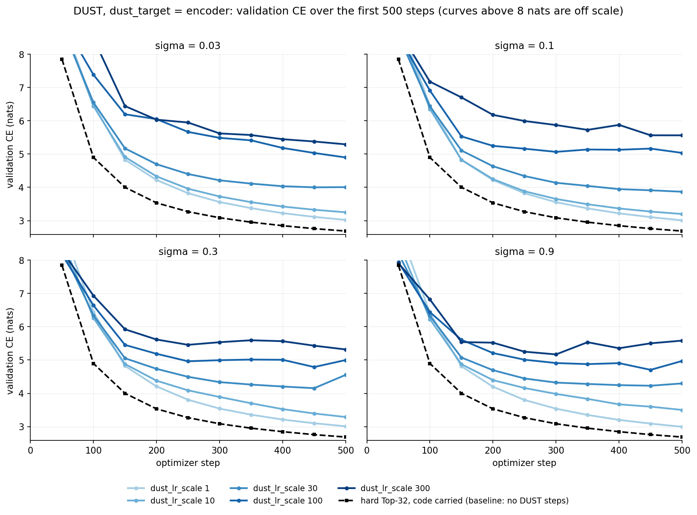
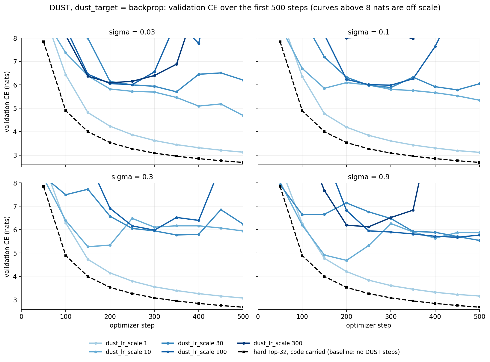
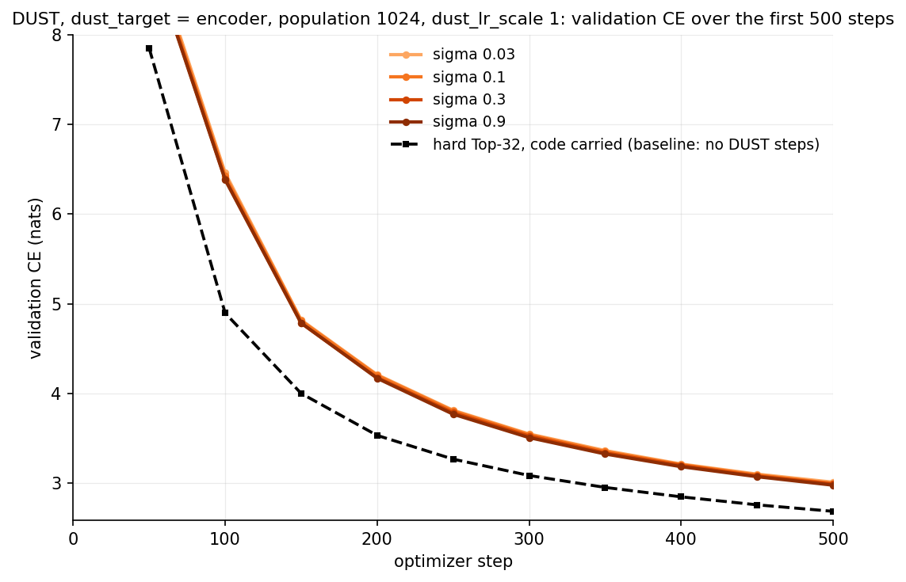
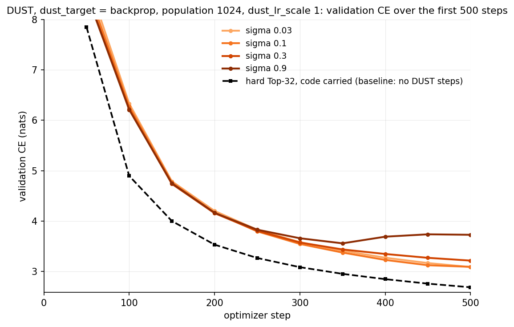
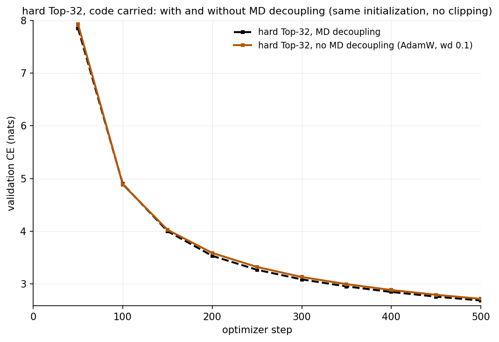
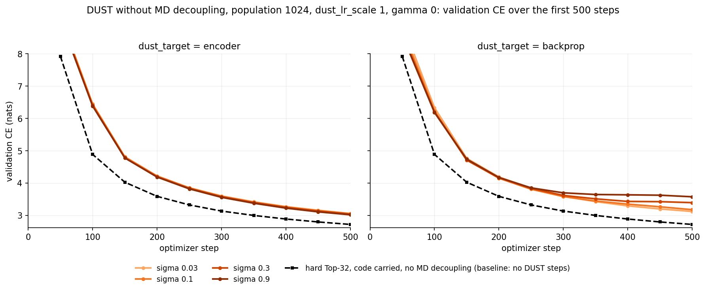
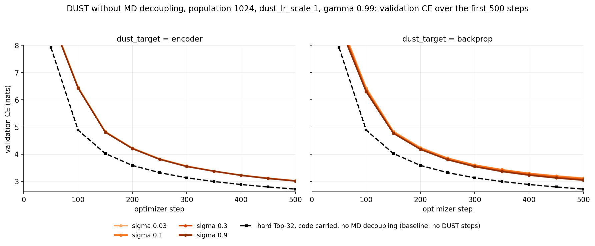

# DUST on the K=32 code-carried model: the 500-step sigma x dust_lr_scale grid

2026-10-22. Single runs, seed 1337; the encoder arm and the baseline on new_york
(8x RTX 5090), the backprop arm on georgia (8x A100).

**Setup.** The model is the K=32 code-carried hard Top-32 model of
`docs/kj-vs-hard-topk-code-residual.tex` (`configs/cr_kj/ma_cr_hard_k32_pnorm.yaml`:
8 blocks of width 768, abs-TopK over N=1536 at `residual_out` of every block, the
code carried between blocks, post-norm, magnitude-direction decoupling, batch
96 x 512 tokens, 20k-step cosine schedule with 500 warmup steps). Every DUST run
(`configs/cr_dust/hp500/`, `docs/dust-topk.md`) adds the DUST bottleneck
optimization with the J=480 pool, population 128 (16 draws per bottleneck),
schedule [1, 1] (every other step a DUST step), gamma 0, grad scale 1, a
separate optimizer for the DUST steps sharing the MD parameterization, and no
gradient clipping; the grid is `dust_target` in {encoder, backprop} x
`dust_sigma` in {0.03, 0.1, 0.3, 0.9} x `dust_lr_scale` in {1, 10, 30, 100, 300}.
Each run trains 500 steps of the unchanged 20k-step schedule, so the window lies
inside the LR warmup (1.2e-6 to 6e-4; the DUST steps use that value times
`dust_lr_scale`), with validation every 50 steps on 40 batches of 24 windows.
The baseline is the same model trained with the same settings and no DUST
steps (`ny_hp500_hard_k32`); the original madrid run of the model (gradient
clipping at 1.0) is quoted for reference.

## Encoder target

Validation CE at step 500:

| sigma \ dust_lr_scale | 1 | 10 | 30 | 100 | 300 |
|---|---|---|---|---|---|
| 0.03 | 3.0220 | 3.2500 | 4.0055 | 4.8971 | 5.2906 |
| 0.1 | 3.0096 | 3.1989 | 3.8673 | 5.0334 | 5.5611 |
| 0.3 | 3.0101 | 3.2891 | 4.5535 | 4.9989 | 5.3168 |
| 0.9 | **2.9957** | 3.5009 | 4.2972 | 4.9715 | 5.5825 |
| hard Top-32 baseline (no DUST steps, same settings) | 2.6875 | | | | |
| hard Top-32, the original madrid run (clipping 1.0) | 2.6846 | | | | |

## Backprop target

Validation CE at step 500:

| sigma \ dust_lr_scale | 1 | 10 | 30 | 100 | 300 |
|---|---|---|---|---|---|
| 0.03 | 3.1246 | 4.6930 | 6.2055 | 13.0487 | 9.7345 |
| 0.1 | 3.1169 | 5.3437 | 6.0478 | 8.8164 | 9.9774 |
| 0.3 | **3.0794** | 5.9428 | 6.2382 | 11.9248 | 9.6194 |
| 0.9 | 3.1646 | 5.8732 | 5.5386 | 5.7687 | 9.2661 |
| hard Top-32 baseline (no DUST steps, same settings) | 2.6875 | | | | |
| hard Top-32, the original madrid run (clipping 1.0) | 2.6846 | | | | |

## Results

No cell reaches the baseline. In both arms the validation CE at step 500 rises
monotonically with `dust_lr_scale`, and the multiplier 1 is the best value at
every sigma: 2.996 to 3.022 in the encoder arm, 0.31 to 0.33 nats above the
baseline, and 3.08 to 3.16 in the backprop arm. The dependence on sigma is weak
at the multiplier 1 (a spread of 0.03 nats in the encoder arm and 0.09 in the
backprop arm) and does not change the ordering by the multiplier anywhere.

The two targets differ in how the larger multipliers fail. In the encoder arm
the curves keep descending at every setting, only more slowly and from a higher
level as the multiplier grows; at 100 and 300 they plateau near 5 to 5.6 nats
within the window. In the backprop arm, where the estimate is backpropagated to
every parameter before the gate inputs, every multiplier from 10 on stalls near
5 to 6 nats, and 100 and 300 diverge at every sigma (final values of 5.8 to 13
nats), with the pre-activation scale growing by orders of magnitude within the
first tens of steps.

Within the first 500 steps the DUST steps therefore cost against hard steps at
every setting of the grid, least when the DUST learning rate is the schedule's
own, and the encoder target is less harmful than the backprop target at every
sigma and multiplier.

## Sigma sweep at population 1024

`dust_lr_scale` 1, population 1024 (128 draws per bottleneck, eight times the
grid's), both targets, the four sigma values, otherwise the grid's settings;
all eight runs on new_york.

Validation CE at step 500 (population 128 at `dust_lr_scale` 1 in parentheses):

| dust_target \ sigma | 0.03 | 0.1 | 0.3 | 0.9 |
|---|---|---|---|---|
| encoder | 3.0117 (3.0220) | 2.9975 (3.0096) | 2.9923 (3.0101) | **2.9790** (2.9957) |
| backprop | 3.0896 (3.1246) | 3.0930 (3.1169) | 3.2166 (3.0794) | 3.7286 (3.1646) |
| hard Top-32 baseline (no DUST steps, same settings) | 2.6875 | | | |
| hard Top-32, the original madrid run (clipping 1.0) | 2.6846 | | | |

Eight times the population lowers the encoder arm's CE at step 500 by 0.010
to 0.018 nats at every sigma, and the four curves are indistinguishable until
the last 100 steps, where they order by sigma with the largest best. The
backprop arm improves by 0.02 to 0.04 at sigma 0.03 and 0.1 and worsens at
0.3 and 0.9, where the curves turn upward after step 350 (sigma 0.9 ends at
3.73). The gap to the baseline, 0.29 nats in the encoder arm at best, is
therefore not a matter of the estimate's variance at this population: the
estimate's variance is eight times smaller and the gap moved by a few
hundredths.

## Without MD decoupling

The hard Top-32 run and the population-1024 sigma sweep (`dust_lr_scale` 1,
both targets) repeated with `model.decouple: false` and `model.md_init: true`:
the initialization is the same, only the optimizer changes, from the
decoupled one (directions on fixed-norm spheres, learnable gains, no weight
decay) to ordinary AdamW with weight decay 0.1, the convention of
`docs/md-init-vs-decoupling.tex`. The hard run and the gamma-0 sweep on
georgia, the gamma-0.99 sweep on new_york; checkpoints at steps 250 and 500.

| run | validation CE at step 500 |
|---|---|
| hard Top-32, MD decoupling | 2.6875 |
| hard Top-32, no MD decoupling (AdamW, weight decay 0.1) | 2.7181 |

The two hard runs coincide to step 150 and separate by 0.03 to 0.06 nats from
step 200 on; at step 500 the decoupled optimizer is 0.031 nats ahead.

### Gamma 0

Validation CE at step 500, without MD decoupling (with MD, from the sweep
above, in parentheses):

| dust_target \ sigma | 0.03 | 0.1 | 0.3 | 0.9 |
|---|---|---|---|---|
| encoder | 3.0558 (3.0117) | 3.0492 (2.9975) | 3.0369 (2.9923) | **3.0163** (2.9790) |
| backprop | 3.1192 (3.0896) | 3.1748 (3.0930) | 3.3926 (3.2166) | 3.5744 (3.7286) |
| hard Top-32, no MD decoupling (no DUST steps, same settings) | 2.7181 | | | |

Removing the decoupling moves the DUST runs by about as much as it moves the
baseline: the encoder arm ends 0.30 to 0.34 nats above the no-MD hard run
(0.29 to 0.32 above the MD hard run with decoupling), ordered by sigma with
the largest best and the four curves indistinguishable to step 400. The
backprop arm ends 0.40 to 0.86 nats above it; its curves separate after step
250 and flatten for sigma 0.3 and 0.9, which end at 3.39 and 3.57 (with
decoupling, sigma 0.9 turned upward to 3.73). The gap between DUST and the
hard model is therefore not a property of the decoupled optimizer.

### Gamma 0.99

The same eight runs with `dust_gamma: 0.99`: a token's noise is rewarded with
its own loss change plus the discounted loss changes of the later tokens.

Validation CE at step 500 (gamma 0 in parentheses):

| dust_target \ sigma | 0.03 | 0.1 | 0.3 | 0.9 |
|---|---|---|---|---|
| encoder | 3.0248 (3.0558) | 3.0193 (3.0492) | 3.0241 (3.0369) | **3.0139** (3.0163) |
| backprop | 3.1229 (3.1192) | 3.1082 (3.1748) | 3.0665 (3.3926) | 3.0437 (3.5744) |
| hard Top-32, no MD decoupling (no DUST steps, same settings) | 2.7181 | | | |

The discounted credit changes the backprop arm most: the flattening at
sigma 0.3 and 0.9 disappears (3.39 to 3.07 and 3.57 to 3.04), the arm is now
ordered by sigma with the largest best, and it ends within 0.03 of the encoder
arm. The encoder arm gains 0.01 to 0.03 nats at sigma 0.03 to 0.3 and nothing
at 0.9, with its four curves again on top of one another. Both arms stay 0.30
to 0.40 nats above the hard run. The per-draw signal-to-noise ratio of the
estimate (`dust/snr`, see `docs/dust-topk.md`) is 0.088 to 0.091 in every
one of these sixteen cells at step 500, independent of sigma, target and
gamma, so at 128 draws per bottleneck the population estimate has a per-token
signal-to-noise ratio of about 1.

## Runs on Drive

Encoder arm, new_york (`gdrive:weight-sparsity/runs_new_york/`):
`ny_hp500_enc_sg0p03_lr1`, `ny_hp500_enc_sg0p03_lr10`, `ny_hp500_enc_sg0p03_lr30`,
`ny_hp500_enc_sg0p03_lr100`, `ny_hp500_enc_sg0p03_lr300`,
`ny_hp500_enc_sg0p1_lr1`, `ny_hp500_enc_sg0p1_lr10`, `ny_hp500_enc_sg0p1_lr30`,
`ny_hp500_enc_sg0p1_lr100`, `ny_hp500_enc_sg0p1_lr300`,
`ny_hp500_enc_sg0p3_lr1`, `ny_hp500_enc_sg0p3_lr10`, `ny_hp500_enc_sg0p3_lr30`,
`ny_hp500_enc_sg0p3_lr100`, `ny_hp500_enc_sg0p3_lr300`,
`ny_hp500_enc_sg0p9_lr1`, `ny_hp500_enc_sg0p9_lr10`, `ny_hp500_enc_sg0p9_lr30`,
`ny_hp500_enc_sg0p9_lr100`, `ny_hp500_enc_sg0p9_lr300`.

Baseline, new_york: `gdrive:weight-sparsity/runs_new_york/ny_hp500_hard_k32`.

Population-1024 sweep, new_york (`gdrive:weight-sparsity/runs_new_york/`):
`ny_hp500_enc_p1024_sg0p03_lr1`, `ny_hp500_enc_p1024_sg0p1_lr1`,
`ny_hp500_enc_p1024_sg0p3_lr1`, `ny_hp500_enc_p1024_sg0p9_lr1`,
`ny_hp500_bp_p1024_sg0p03_lr1`, `ny_hp500_bp_p1024_sg0p1_lr1`,
`ny_hp500_bp_p1024_sg0p3_lr1`, `ny_hp500_bp_p1024_sg0p9_lr1`.

Backprop arm, georgia (`gdrive:weight-sparsity/runs_georgia/`):
`ga_hp500_bp_sg0p03_lr1`, `ga_hp500_bp_sg0p03_lr10`, `ga_hp500_bp_sg0p03_lr30`,
`ga_hp500_bp_sg0p03_lr100`, `ga_hp500_bp_sg0p03_lr300`,
`ga_hp500_bp_sg0p1_lr1`, `ga_hp500_bp_sg0p1_lr10`, `ga_hp500_bp_sg0p1_lr30`,
`ga_hp500_bp_sg0p1_lr100`, `ga_hp500_bp_sg0p1_lr300`,
`ga_hp500_bp_sg0p3_lr1`, `ga_hp500_bp_sg0p3_lr10`, `ga_hp500_bp_sg0p3_lr30`,
`ga_hp500_bp_sg0p3_lr100`, `ga_hp500_bp_sg0p3_lr300`,
`ga_hp500_bp_sg0p9_lr1`, `ga_hp500_bp_sg0p9_lr10`, `ga_hp500_bp_sg0p9_lr30`,
`ga_hp500_bp_sg0p9_lr100`, `ga_hp500_bp_sg0p9_lr300`.

Without MD decoupling, georgia (`gdrive:weight-sparsity/runs_georgia/`):
`ga_hp500_hard_k32_nomd`,
`ga_hp500_enc_p1024_nomd_sg0p03_lr1`, `ga_hp500_enc_p1024_nomd_sg0p1_lr1`,
`ga_hp500_enc_p1024_nomd_sg0p3_lr1`, `ga_hp500_enc_p1024_nomd_sg0p9_lr1`,
`ga_hp500_bp_p1024_nomd_sg0p03_lr1`, `ga_hp500_bp_p1024_nomd_sg0p1_lr1`,
`ga_hp500_bp_p1024_nomd_sg0p3_lr1`, `ga_hp500_bp_p1024_nomd_sg0p9_lr1`.

Without MD decoupling, gamma 0.99, new_york (`gdrive:weight-sparsity/runs_new_york/`):
`ny_hp500_enc_p1024_nomd_g099_sg0p03_lr1`, `ny_hp500_enc_p1024_nomd_g099_sg0p1_lr1`,
`ny_hp500_enc_p1024_nomd_g099_sg0p3_lr1`, `ny_hp500_enc_p1024_nomd_g099_sg0p9_lr1`,
`ny_hp500_bp_p1024_nomd_g099_sg0p03_lr1`, `ny_hp500_bp_p1024_nomd_g099_sg0p1_lr1`,
`ny_hp500_bp_p1024_nomd_g099_sg0p3_lr1`, `ny_hp500_bp_p1024_nomd_g099_sg0p9_lr1`.

Original hard Top-32 run (reference value only):
`gdrive:weight-sparsity/runs_madrid/ma_cr_hard_k32_pnorm`.

Figures and tables: `scripts/plot_dust_hp500.py` over the `metrics.jsonl` of
these runs.
