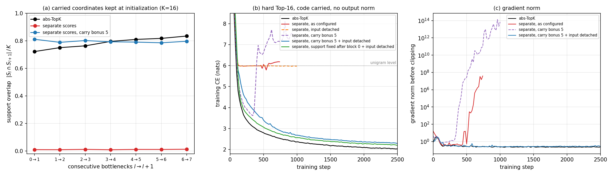

# Why hard Top-K with separately computed selection scores fails under the code residual

2026-11-12. Measurements on the `cairo` box (runs `sx_sep_k16_*`, `sx_sep_k32_*`);
references from the Gumbel campaign (`gcr_hard_abs_k16`, `gcr_hard_abs_k32`,
`gcr_hard_sep_k16`).

**Setup.** The model is the 8-block, 768-wide TinyStories transformer with an
activation bottleneck after every block (`placement: residual_out`, $N = 1536$
code coordinates). The bottlenecks are code-carried (`code_residual: true`),
have no output norm (`post_norm: false`), and train at a constant learning
rate of 6e-4 after a 500-step warmup (`configs/gumbel_cr/base.yaml`). Each
bottleneck keeps a *support* $S_l$ of exactly $K$ coordinates, given by a hard
binary mask $m_l$. Two ways of choosing the support are compared:

- **abs-TopK** (`selection_mode: abs_topk`): $S_l$ holds the $K$ coordinates of
  largest magnitude $|a_i|$ of the code $a$ itself.
- **Separate scores** (`selection_mode: learned_score_topk`): an independent
  linear scorer $s = W_s h + b_s$ reads the residual-stream state $h$, and
  $S_l$ holds the $K$ largest $s_i$. The code values $v = a$ are kept unscaled
  on $S_l$. The mask passes no gradient to $s$, so the scorer is trained by the
  *support gradient*
  $\partial L/\partial s_i = \mathbb 1[i \in S]\,\mathrm{sign}(v_i)\,\partial L/\partial y_i$,
  with $y = v \odot m$ the bottleneck output.

The separate-score runs failed for two reasons, and each has a fix. With both
fixes the runs train, but they still trail abs-TopK.

*Figure.* (a) Share of the carried coordinates that the next bottleneck keeps,
at initialization, $K = 16$. (b) Training CE of hard Top-16 in six
configurations; the dotted line is the unigram level (5.99 nats). (c) Gradient
norm before clipping, log scale. The as-configured run was stopped at step 740.

## 1. The independent scores cut the code skip, so training stalls at the unigram level

Under the code residual, a block's input reaches later blocks only through the
carried code $c_l$, on the coordinates the next support keeps:

$$
x_{l+1}=D\,c_{l+1},\qquad c_{l+1}=(c_l+E\,\Delta_l)\odot m_{l+1},
$$

where $x_{l+1}$ is the stream block $l+1$ reads, $\Delta_l$ the output of
block $l$'s attention and MLP branches, and $E$, $D$ the bottleneck's encoder
and decoder. abs-TopK selects the large carried coordinates again, because
they dominate $c_l + E\Delta_l$. A randomly initialized scorer selects
independently of $c_l$, so consecutive supports share about $K/N$ of their
coordinates: 0.010 at $K = 16$, against 0.78 for abs-TopK (panel a). The skip
path is gone at initialization.

**Fix:** a bonus on the scores of the coordinates the carried code occupies,

$$
s_l \leftarrow s_l + \gamma\,\mathbb 1[c_l \neq 0] \qquad (l \ge 1),
$$

(`learned_score_carry_bonus: γ`). $\gamma = 5$ restores an overlap of 0.80.
A very large $\gamma$ fixes the support after block 0.

## 2. The scorer's support gradient flowing into the trunk makes training diverge

$s$ affects the loss only through ranking. So the term
$W_s^\top\big(\mathrm{sign}(v)\odot\partial L/\partial y\big)$ that the support
gradient sends into $h$ is not a gradient of the loss, and it grows with
$\|W_s\|$, which it also inflates. The score gap and the gradient norm grow
without bound, to about $10^{14}$ (panel c), and training diverges (panel b,
carry bonus alone).

**Fix:** detach $h$ in the scorer (`learned_score_input_grad: false`). The
scorer still learns from the support gradient; the trunk gets none of it.

## Results

Validation CE of separate-score hard Top-16 (abs-TopK hard Top-16: 2.39 at step 1000):

| variant | val CE at 1000 |
|---|---|
| as configured | 5.99 (stall), then diverges; stopped at step 740 |
| scorer input detached only | 5.99 |
| carry bonus only ($\gamma = 5$) | 4.13 at step 200, then diverges |
| carry bonus, scorer frozen | 3.78 |
| carry bonus + detached input | 2.70 |
| support fixed after block 0 + detached input | 2.59 |

At step 2500 the fixed runs still lag abs-TopK:

| run | val CE at 2500 | abs-TopK at 2500 |
|---|---|---|
| Top-16, $\gamma = 5$ + detached input | 2.338 | 2.064 |
| Top-16, support fixed after block 0 + detached input | 2.249 | 2.064 |
| Top-32, $\gamma = 5$ + detached input | 2.124 | 1.959 |

All runs are single runs at seed 1337. What causes the remaining 0.17–0.27
nats has not been investigated.

**Code and data.** Config fields `learned_score_carry_bonus` (default 0) and
`learned_score_input_grad` (default true); the overlap measurement
`analysis/code_carry_overlap.py`; the figure
`scripts/plot_separate_score_failure.py` with its data in
`docs/figures/separate-score/data/`. Runs on Drive: `runs_cairo/sx_*`,
`runs_bern/gcr_hard_sep_k16`, `runs_ankara/gcr_hard_abs_k16`.
